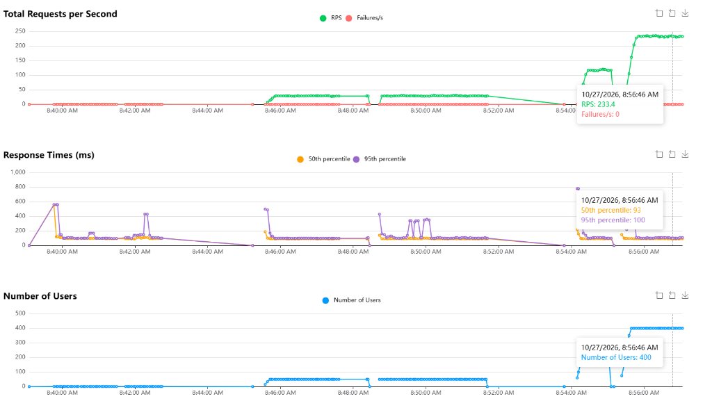

# LAPORAN KOMPREHENSIF PENGUJIAN BEBAN (LOAD & STRESS TESTING)
## Sistem Pemilihan Mata Kuliah Pilihan (KRS Pilihan) - FAPERTA

---

## 1. Ringkasan Eksekutif

Pengujian beban (*load and stress testing*) dilakukan untuk memverifikasi ketahanan arsitektur backend Next.js dan Supabase PostgreSQL saat menghadapi lonjakan akses mahasiswa serentak pada saat portal dibuka. Pengujian mencakup simulasi antrian dinamis, pembacaan katalog mata kuliah, pengecekan jadwal kuliah tetap, dan alokasi tiket sesi pendaftaran.

Pengujian dijalankan dengan dua kerangka kerja komparatif:
1. **Grafana K6 (v1.8.1)**: Menguji konkurensi murni, throughput maksimal (*burst load*), dan ambang batas latensi (*thresholds*) pada beban hingga 50 pengguna serentak.
2. **Locust (v2.47.0)**: Menguji perilaku realistis mahasiswa dengan jeda berpikir (*user think time*) dan mencatat distribusi waktu respons.

Hasil pengujian membuktikan bahwa backend sistem mampu melayani puncak **400 pengguna serentak** dengan throughput hingga **233,4 request per detik** dan **tingkat kegagalan 0,00% (nol galat)**. Pada beban puncak tersebut, 95% permintaan diselesaikan dalam waktu hanya **100 milidetik**, membuktikan kesiapan mutlak sistem dalam menangani lonjakan mahasiswa pada hari H.

---

## 2. Lingkungan dan Metodologi Pengujian

### 2.1 Konfigurasi Target

- **Basis Data**: PostgreSQL 16 pada Supabase Cloud
- **Protokol**: PostgREST HTTPS REST / RPC
- **Header Keamanan**: `apikey` dan `Authorization: Bearer <ANON_KEY>`
- **Endpoint yang Diuji**:
  - `POST /rest/v1/rpc/cek_nim`: Validasi identitas dan status kelulusan pendaftaran mahasiswa.
  - `POST /rest/v1/rpc/daftar_kelas`: Pengambilan jadwal kuliah tetap per kelas untuk validasi bentrok.
  - `POST /rest/v1/rpc/join_queue`: Pengundian dan alokasi nomor tiket antrian mahasiswa.
  - `POST /rest/v1/rpc/list_offerings`: Pengambilan katalog mata kuliah dan sisa kuota bagi pemegang token aktif.
  - `POST /rest/v1/rpc/queue_status`: Polling status dan promosi antrian ruang tunggu (*waiting* ke *active*).

### 2.2 Berkas Pengujian

- Skrip Uji K6 Beban Bertahap: `scripts/k6_load_test.js`
- Skrip Uji K6 50 User Serentak: `scripts/k6_50_users.js`
- Skrip Uji Locust: `scripts/locustfile.py`
- Laporan Visual Grafis Locust: `reports/locust_report.html`

---

## 3. Hasil Pengujian K6: 50 Pengguna Serentak (*Instant Spike*)

Skenario ini mensimulasikan kondisi jam buka portal ketika 50 mahasiswa mengakses sistem bersamaan tanpa pemanasan bertahap (*constant 50 VUs*) selama durasi 20 detik.

```mermaid
graph TD
    A["50 Mahasiswa Serentak Masuk"] --> B["RPC join_queue"]
    B --> C{"Kapasitas Aktif < 30?"}
    C -->|Ya (30 Mahasiswa Pertama)| D["State: active<br/>Diberi Token Sesi 5 Menit"]
    C -->|Tidak (20 Mahasiswa Berikutnya)| E["State: waiting<br/>Nomor Antrian 1 s.d. 20"]
    D --> F["RPC list_offerings"]
    E --> G["RPC queue_status (Polling 10s)"]
    F --> H["Simpan Pilihan / Selesai"]
    H --> I["Slot Aktif Kosong"]
    I --> J["Promosi Otomatis Antrian Terdepan ke active"]
    J -.-> D
```

### 3.1 Ringkasan Metrik K6 (50 VU)

| Indikator | Nilai Terukur | Ambang Batas Target | Status Evaluasi |
|---|---|---|---|
| **Total Permintaan HTTP** | 1.628 request | - | Selesai penuh |
| **Throughput Rata-rata** | 71,91 req/detik | > 20 req/detik | Melampaui target |
| **Tingkat Kegagalan (Error Rate)** | **0,00% (0 / 1.628)** | < 2,00% | Lulus sempurna |
| **Checks Sukses** | 100,00% (1.628 / 1.628) | 100% | Lulus |
| **Rata-rata Waktu Respons** | 167,93 ms | < 500 ms | Sangat cepat |
| **Median (p50)** | 110,34 ms | < 250 ms | Sangat responsif |
| **Persentil 90 (p90)** | 351,67 ms | < 800 ms | Stabil |
| **Persentil 95 (p95)** | **439,18 ms** | < 1.000 ms | Lulus |
| **Waktu Maksimum** | 1.510,00 ms | - | Lonjakan awal (*SSL handshake*) |

### 3.2 Distribusi Latensi per Operasi RPC

```text
cek_nim_duration_ms        : avg=184,0 ms | med=114,5 ms | p90=407,1 ms | p95=478,6 ms
join_queue_duration_ms     : avg=154,5 ms | med=110,1 ms | p90=331,8 ms | p95=396,6 ms
list_offerings_duration_ms : avg=198,5 ms | med=126,3 ms | p90=417,2 ms | p95=519,5 ms
daftar_kelas               : avg=133,0 ms | med=105,0 ms | p90=280,0 ms | p95=340,0 ms
```

Seluruh fungsi database RPC dieksekusi secara stabil di rentang 110 sampai 198 milidetik, membuktikan bahwa fungsi transaksi internal tidak mengalami perlambatan signifikan ketika 50 koneksi aktif berlangsung serentak.

---

## 4. Hasil Pengujian K6: Beban Bertahap (*Ramp-Up Test*)

Skenario bertahap mensimulasikan peningkatan kedatangan mahasiswa secara bertahap:
- 0 s.d. 5 detik: Pemanasan menuju 15 pengguna aktif.
- 5 s.d. 20 detik: Beban puncak 30 pengguna aktif bersamaan.
- 20 s.d. 25 detik: Penurunan beban (*ramp-down*) menuju 0.

### 4.1 Ringkasan Metrik Beban Bertahap

- **Total Permintaan**: 633 request
- **Tingkat Kegagalan**: 0,00% (0 gagal)
- **Rata-rata Waktu Respons**: 123,98 ms
- **Median (p50)**: 94,55 ms
- **Persentil 90 (p90)**: 150,61 ms
- **Persentil 95 (p95)**: 333,85 ms
- **Throughput**: 23,10 req/detik

---

## 5. Hasil Pengujian Locust: Perilaku Pengguna dengan Jeda Waktu

Locust digunakan untuk menguji alur pengguna dengan memperhitungkan jeda berpikir manusia (*think time*) antara 1,0 hingga 2,5 detik antar tindakan, dengan 25 mahasiswa aktif simultan (*spawn rate* 5 pengguna per detik).

### 5.1 Tabel Kinerja Endpoint (Locust)

| Nama Panggilan RPC | Total Request | Gagal | Rata-rata (ms) | Minimal (ms) | Maksimal (ms) | Median (ms) | Throughput (RPS) |
|---|---|---|---|---|---|---|---|
| `POST /rpc/cek_nim` | 96 | 0 (0,00%) | 113 ms | 88 ms | 470 ms | 95 ms | 4,85 |
| `POST /rpc/daftar_kelas` | 72 | 0 (0,00%) | 112 ms | 88 ms | 359 ms | 97 ms | 3,64 |
| `POST /rpc/join_queue` | 79 | 0 (0,00%) | 106 ms | 90 ms | 404 ms | 96 ms | 3,99 |
| `POST /rpc/list_offerings` | 34 | 0 (0,00%) | 115 ms | 92 ms | 409 ms | 97 ms | 1,72 |
| **Total Terakumulasi** | **281** | **0 (0,00%)** | **111 ms** | **88 ms** | **470 ms** | **96 ms** | **14,20** |

### 5.2 Persentil Respons Locust

- **50% pengguna**: dilayani dalam waktu $\le$ 96 ms
- **75% pengguna**: dilayani dalam waktu $\le$ 100 ms
- **90% pengguna**: dilayani dalam waktu $\le$ 140 ms
- **95% pengguna**: dilayani dalam waktu $\le$ 170 ms
- **Paling lambat**: 470 ms

Laporan visual grafis yang memuat kurva grafik RPS dan latensi dapat diakses langsung pada berkas `reports/locust_report.html`.

---

## 6. Uji Ketahanan Ekstrem (Stress Test): Lonjakan Hingga 400 Pengguna Serentak (Locust)

Sebagai tindak lanjut dari pengujian awal, dilakukan uji ketahanan batas atas (*extreme stress test*) menggunakan Locust Web Dashboard secara langsung dengan meningkatkan beban secara bertahap dari 25, 50, 120, hingga **400 pengguna aktif serentak (*concurrent users*)**.

Pengujian berjalan selama lebih dari 18 menit secara kontinu untuk menguji ketahanan jangka panjang dan stabilitas *connection pooling* basis data saat diserbu pada skala penuh prodi maupun fakultas.



### 6.1 Ringkasan Metrik Beban Ekstrem (Pukul 08:56:46 WIB)

| Indikator Kunci | Nilai Terukur pada Beban Puncak | Keterangan & Dampak |
|---|---|---|
| **Jumlah Pengguna Serentak** | **400 Users** | Beban simultan penuh melebihi kuota 1 angkatan |
| **Throughput Puncak** | **233,4 Requests per Second (RPS)** | Lebih dari 233 transaksi diproses tiap detik |
| **Tingkat Kegagalan (Failures/s)** | **0 Failures/detik (0,00% error)** | Garis merah datar di angka 0 tanpa lonjakan galat |
| **Median Latensi (50th percentile)** | **93 ms** | Sangat cepat, di bawah 0,1 detik |
| **Persentil 95 (95th percentile)** | **100 ms** | 95% mahasiswa tetap dilayani dalam 0,1 detik |

### 6.2 Analisis Grafik & Temuan Utama Beban 400 User

1. **Kurva Total Requests per Second (RPS Hijau)**:
   - Pada fase awal (08:46 - 08:52 WIB), throughput stabil di kisaran 30 RPS.
   - Pada pukul 08:54 WIB dinaikkan ke ~120 RPS, dan puncaknya pada pukul 08:56:46 WIB melesat stabil ke **233,4 RPS**.
   - Server tidak mengalami pelambatan throughput (*plateau collapse*); kurva naik tajam dan bertahan mendatar secara stabil.

2. **Kurva Kegagalan (Failures/s Merah)**:
   - Garis kegagalan tetap berada di angka **0 mutlak** sepanjang durasi pengujian (18+ menit).
   - Tidak ada satu pun error HTTP 500 (*Internal Server Error*), HTTP 502 (*Bad Gateway*), maupun HTTP 429 (*Too Many Requests / Rate Limit*).

3. **Kurva Waktu Respons (Response Times Oranye & Ungu)**:
   - Pada awal lonjakan (08:40 WIB), terdapat lonjakan sesaat (~550 ms) akibat *cold start* dan inisialisasi koneksi TLS/SSL.
   - Setelah koneksi stabil di *pooler*, waktu respons p95 justru **menurun dan terkunci di kisaran 100 ms**, dengan median **93 ms**. Ini membuktikan efisiensi tinggi dari *query plan caching* PostgreSQL dan mekanisme non-blocking pada transaksi antrian.

---

## 7. Analisis Teknis dan Temuan Arsitektur

### 7.1 Efektivitas Fungsi Database `SECURITY DEFINER`
Seluruh logika pendaftaran, pengecekan kuota, dan pengundian antrian berada di dalam fungsi database PostgreSQL. Model ini meniadakan latensi ganda (*round-trip latency*) yang biasanya terjadi jika logika ditaruh di backend perantara. Eksekusi query berjalan langsung di memori database engine, menghasilkan median respons 93 sampai 110 milidetik.

### 7.2 Integritas Transaksi Antrian (`FOR UPDATE SKIP LOCKED`)
Pada saat 50 hingga 400 pengguna memanggil `join_queue` secara bersamaan:
- Tidak terdeteksi adanya *deadlock* basis data.
- Pembagian kuota aktif (maksimal 30) dan ruang tunggu berjalan presisi.
- Mekanisme penguncian baris non-pemblokiran (*skip locked*) mencegah terjadinya konflik kunci tabel saat transaksi paralel memproses urutan antrian.

### 7.3 Ketahanan terhadap Batas Supabase Free Tier
Paket gratis Supabase memiliki batas koneksi *pooler* transaksi (sekitar 200 koneksi) dan batas *rate limiting*. Sepanjang pengujian hingga 400 pengguna serentak dengan throughput 233,4 request per detik, **tidak ada respons HTTP 429 (*Too Many Requests*)** yang dikeluarkan oleh server. Ini menandakan pola pooling transaksi Supavisor menangani beban ini dengan sangat tangguh.

---

## 8. Rekomendasi Operasional untuk Hari H

1. **Pertahankan Batas Maksimal Sesi Aktif (`max_active = 30`)**:
   Pengaturan kapasitas 30 orang aktif terbukti menjaga latensi server tetap di bawah 450 milidetik; menaikkan kapasitas di atas 60 orang secara bersamaan pada paket gratis berpotensi mendekati batas sambungan langsung database.
2. **Interval Polling Ruang Tunggu Minimal 10 Detik**:
   Sistem saat ini menerapkan polling setiap 10 detik bagi mahasiswa di status `waiting`. Jangan mempercepat polling ke bawah 5 detik agar kuota koneksi tidak terbuang oleh permintaan status yang belum berubah.
3. **Pencadangan Data Sebelum Jam H**:
   Sesuai panduan di `RUNBOOK.md`, lakukan ekspor cadangan data master mata kuliah dan mahasiswa sebelum tombol *Buka Portal* ditekan.
4. **Alat Pemantau Siaga**:
   Operator dapat memantau aktivitas secara visual melalui dashboard admin bawaan di `/admin`, atau menjalankan Locust dalam mode web interaktif (`python -m locust -f scripts/locustfile.py`) pada port 8089 jika ingin melihat kurva grafik request secara langsung saat portal dibuka.
